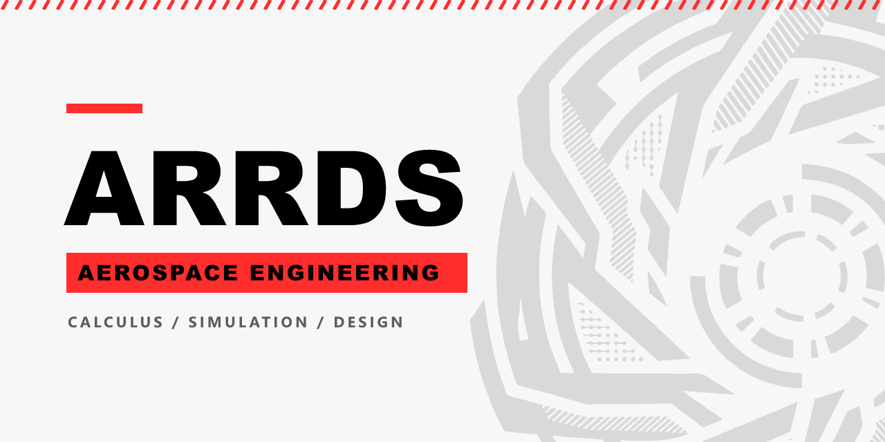

🇬🇧 [Read in English](README.md)

# Arrds

Soy estudiante de Ingeniería Aeroespacial. Desarrollo herramientas de cálculo, simulación y diseño orientadas a la ingeniería aeroespacial, y me dedico a crear contenido técnico en inglés y español.

## Proyectos en desarrollo

Mis repositorios se encuentran actualmente en proceso de desarrollo y serán abiertos al público próximamente:

- **aerospace-engineering-notes:** colección abierta de apuntes, material interactivo y proyectos de ingeniería aeroespacial, organizada por disciplina y redactada en inglés y español.
- **arrds-math-engine:** motor matemático para cálculo simbólico y numérico, con un intérprete de LaTeX propio, orientado a resolver y verificar problemas de ingeniería.
- **motor-OCR:** motor híbrido para convertir PDF con contenido matemático a LaTeX y Markdown, que combina reglas deterministas con inteligencia artificial únicamente en los casos ambiguos.
- **skillset-arrds:** conjunto de skills de Claude Code y herramientas propias para la ingeniería aeroespacial.

## Próximos pasos

Me dispongo a dedicar el próximo tramo de trabajo a migrar los avances de código a **C++**.

## Colaboración

Estoy abierto a colaboraciones y comentarios. Puedes ponerte en contacto conmigo a través de GitHub.

## Tecnologías y herramientas

