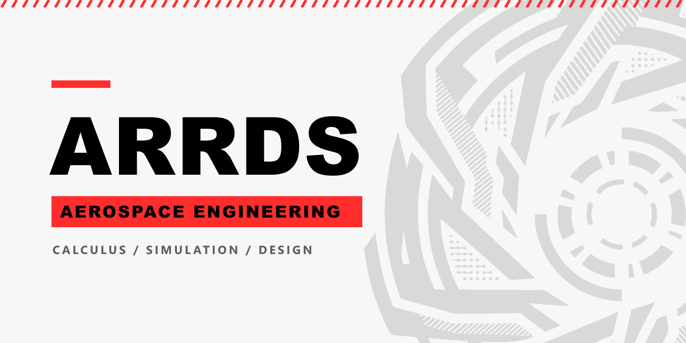

🇪🇸 [Leer en español](README.es.md)

# Arrds

I am an aerospace engineering student. I develop calculation, simulation and design tools for aerospace engineering, and I create technical content in English and Spanish.

## Projects in development

My repositories are currently under development and will be made public soon:

- **aerospace-engineering-handbook-arrds:** an open reference handbook on aerospace engineering, with formulas, tables, criteria and procedures, organized by discipline and written in English and Spanish.
- **arrds-mathcore:** a mathematical engine for symbolic and numerical computation, with its own LaTeX interpreter, aimed at solving and verifying engineering problems.
- **arrds-ocr:** a hybrid engine that converts PDFs with mathematical content into LaTeX and Markdown, combining deterministic rules with artificial intelligence only for ambiguous cases.
- **skillset-arrds:** a set of Claude Code skills and custom tools for aerospace engineering.

## Next steps

I am about to dedicate the next stretch of work to migrating my code progress to **C++**.

## Collaboration

I am open to collaboration and feedback. You can get in touch through GitHub.

## Technologies and tools

